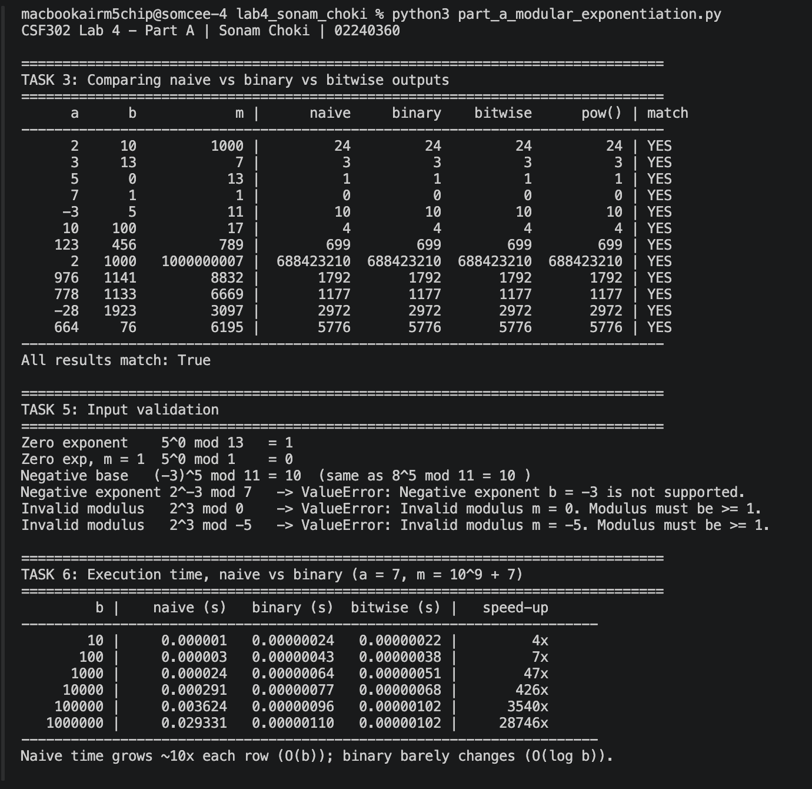
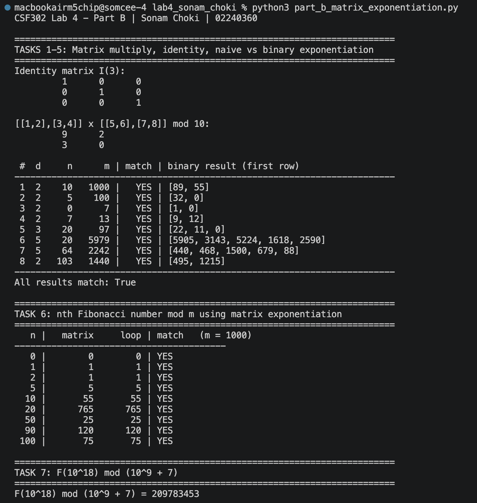
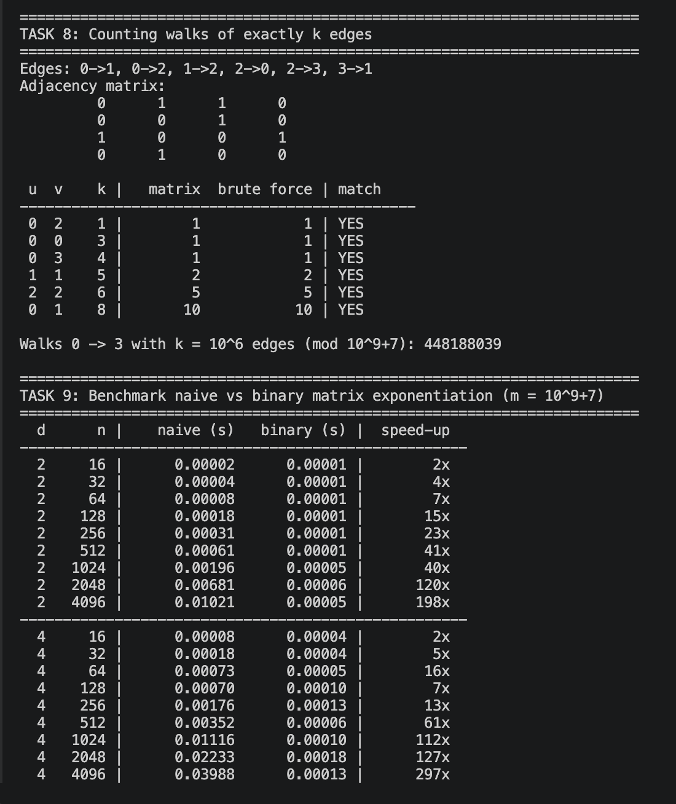
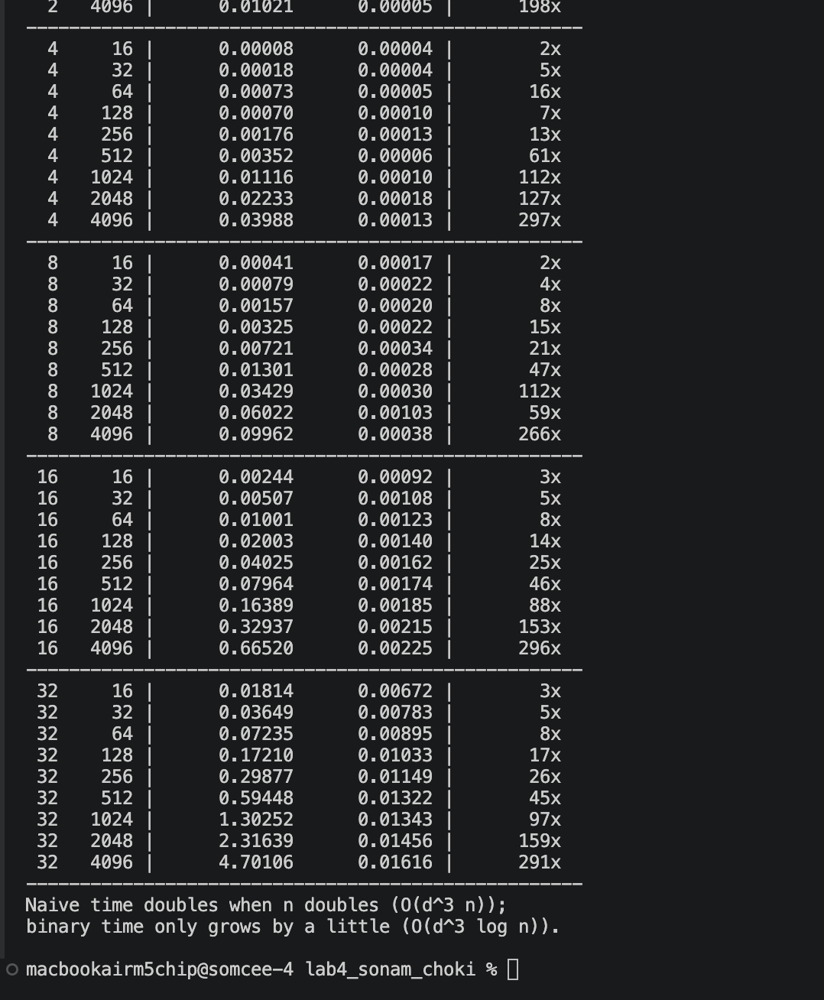

# CSF302 – Lab 4: Modular and Matrix Exponentiation

**Name:** Sonam Choki
**Student Number:** 02240360

---

## Files

| File | What it contains |
|------|------------------|
| `part_a_modular_exponentiation.py` | Part A: naive, binary and bitwise modular exponentiation, input validation, timing |
| `part_b_matrix_exponentiation.py` | Part B: matrix multiply, identity, naive and binary matrix power, Fibonacci, graph walks, benchmark |
| `output_part_a.txt` / `output_part_b.txt` | Text copy of the program output |
| `screenshots/` | Screenshots of the output on my Mac |

---

### The big idea
Calculating something like 7^1,000,000 the obvious way means doing **a million multiplications**.
The clever way (**binary exponentiation**, or "square-and-multiply") uses the fact that

- a^b = (a^(b/2))², when b is even
- a^b = a · a^(b−1), when b is odd

so each step **halves** the exponent. That needs only about **log₂(b)** steps:
around 20 for one million, and around 60 for 10^18.

Taking `mod m` after every multiplication keeps the numbers small, so they never blow up.

### Part A: Modular exponentiation (numbers)
1. **Naive:** multiply `a` by itself `b` times, taking `mod m` each time. Time is **O(b)**.
2. **Binary:** square-and-multiply using `b % 2` and `b // 2`. Time is **O(log b)**.
3. **Comparison:** all versions give the same answer on many test cases, checked against Python's built-in `pow(a, b, m)`.
4. **Bitwise version:** `b & 1` checks whether `b` is odd (it looks at the last bit), and `b >>= 1` halves `b` (it shifts the bits right). These are slightly faster than `%` and `//`.
5. **Input validation:**
   - `b = 0` returns `1 mod m` (so the answer is 0 when m = 1)
   - `b < 0` raises an error
   - negative `a` is turned into a positive number first using `a mod m`
   - `m < 1` raises an error
6. **Timing:** as `b` goes from 10 to 10^6, the naive time grows about **10× per step**,
   but binary stays almost flat. At b = 10^6, binary is **thousands of times faster**.

### Part B: Matrix exponentiation
The same "halve the exponent" trick works for **matrices**. The only change is that
multiplying numbers becomes multiplying matrices.

1. **Matrix multiply mod m:** the normal row × column rule, with `mod m` on each entry. Costs O(d³).
2. **Identity matrix:** 1s on the diagonal and 0s elsewhere. It plays the role of "1" for matrices.
3. **Naive matrix power:** multiply A by itself n times. Time is **O(d³ · n)**.
4. **Binary matrix power:** repeated squaring. Time is **O(d³ · log n)**.
5. **Comparison:** naive and binary give identical matrices on all tests.
6. **Fibonacci:** [[1,1],[1,0]]^n = [[F(n+1), F(n)], [F(n), F(n−1)]], so F(n) is the top-right entry.
7. **F(10^18) mod (10^9+7) = 209783453.** This is computed in under a millisecond with about 60 squarings, without generating any earlier Fibonacci numbers.
8. **Graph walks:** if A is a graph's adjacency matrix, then entry (u, v) of A^k is the number of walks from u to v using exactly k edges. I checked this against a brute-force path counter.
9. **Benchmark:** for d = 2…32 and n = 2^4…2^12, naive time **doubles every time n doubles**,
   while binary time barely changes. At d = 32 and n = 4096 the naive version took 4.70 s and binary took 0.016 s, which is about **291× faster**.

### Conclusion
Binary exponentiation turns a **linear-time** job into a **logarithmic-time** job,
for both numbers and matrices. This makes huge problems, like F(10^18) or 10^6-step graph walks,
solvable instantly. The same idea is used in RSA cryptography, in fast Fibonacci/recurrence computation, and in counting paths in graphs.

---

## Output 

### Part A: Modular exponentiation (Tasks 3, 5 and 6)

**What it shows:**
- **Task 3:** all 12 test cases give the same answer with the naive, binary and bitwise methods and with Python's `pow()`, so the output ends with `All results match: True`.
- **Task 5:** a zero exponent gives `1 mod m`, a negative base is reduced first, and a negative exponent or a modulus below 1 raises a `ValueError`.
- **Task 6:** at b = 10^6 the naive method took **0.029 s**, while the bitwise binary method took **0.000001 s**. That is about **28,746× faster**.

### Part B: Matrix exponentiation (Tasks 1–7)

**What it shows:**
- **Tasks 1–2:** the identity matrix I(3) and a 2×2 matrix multiplication mod 10.
- **Tasks 3–5:** naive and binary matrix power give the same result on all 8 test cases, so the output ends with `All results match: True`.
- **Task 6:** the matrix method gives the same Fibonacci numbers as a simple loop.
- **Task 7:** **F(10^18) mod (10^9 + 7) = 209783453**

### Part B: Graph walks (Task 8) and benchmark (Task 9)

**What it shows:**
- **Task 8:** the matrix method and the brute-force method give the same number of walks every time. It also counts the walks from 0 to 3 with 10^6 edges: **448188039** (mod 10^9+7).
- **Task 9:** naive time roughly doubles every time n doubles. Binary time hardly changes. At d = 32 and n = 4096, naive took **4.70 s** and binary took **0.016 s**, about **291× faster**.
