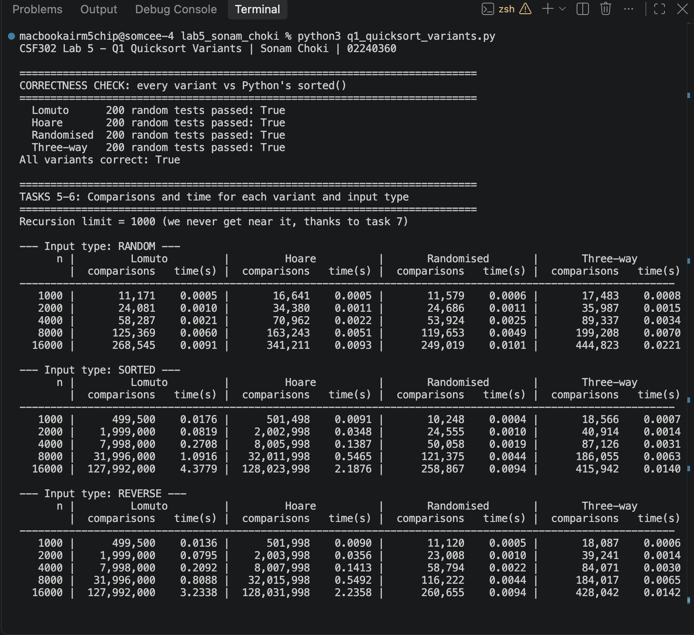
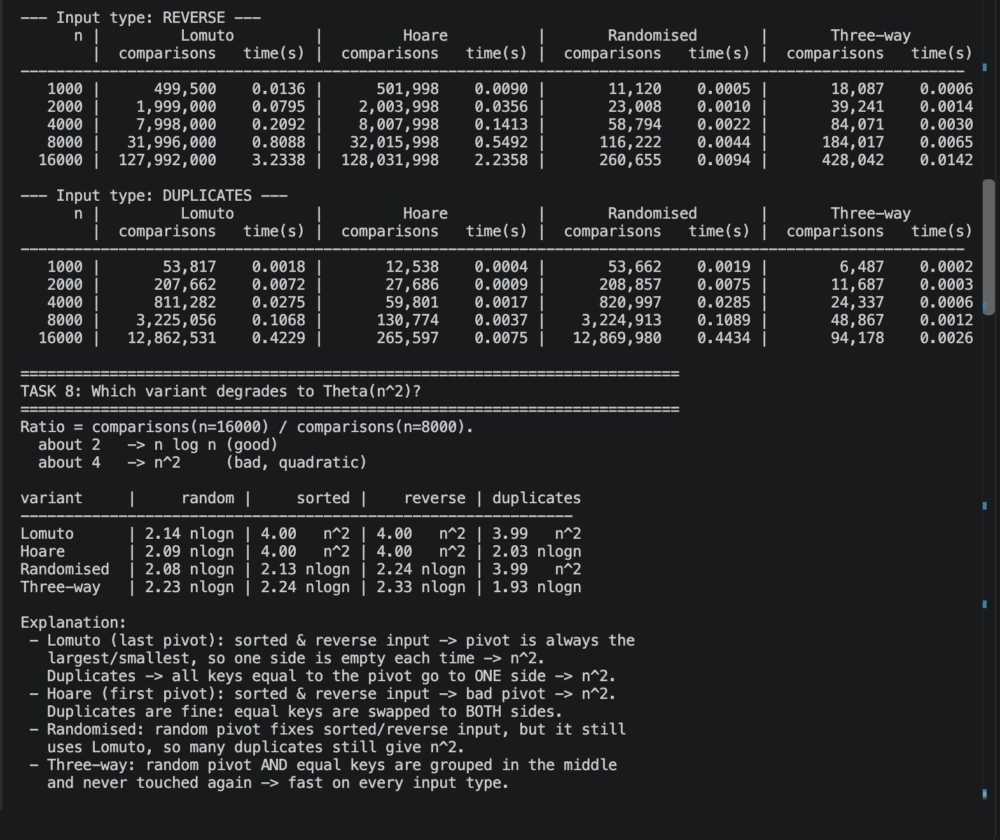
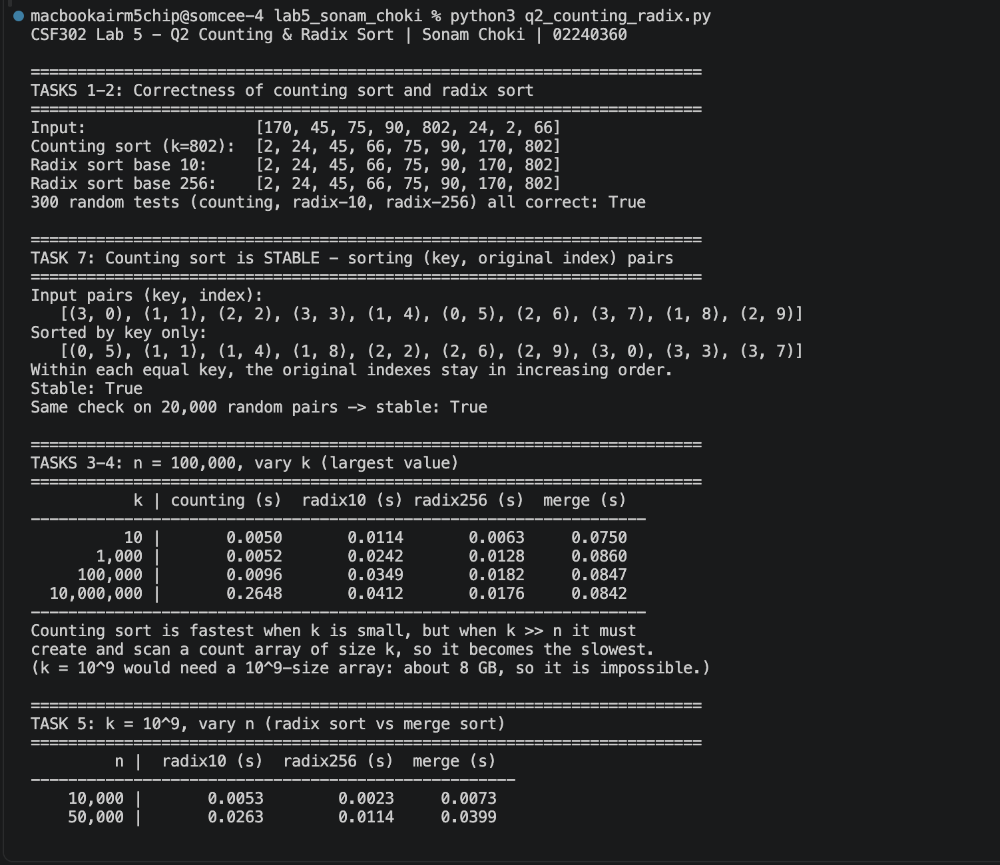
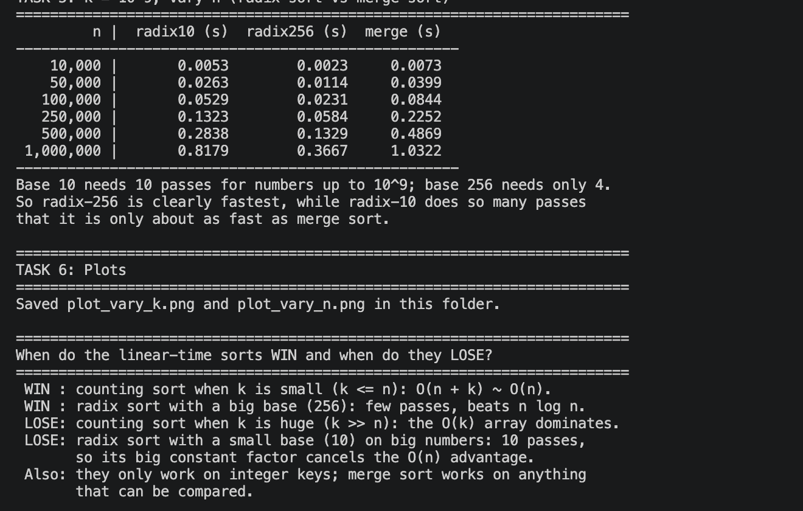
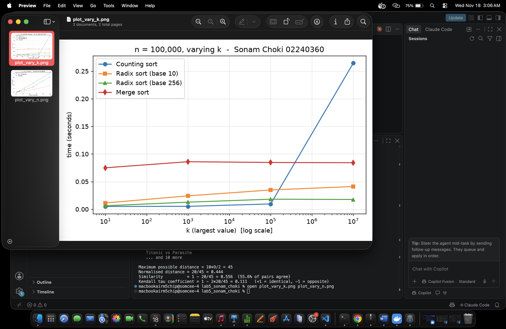
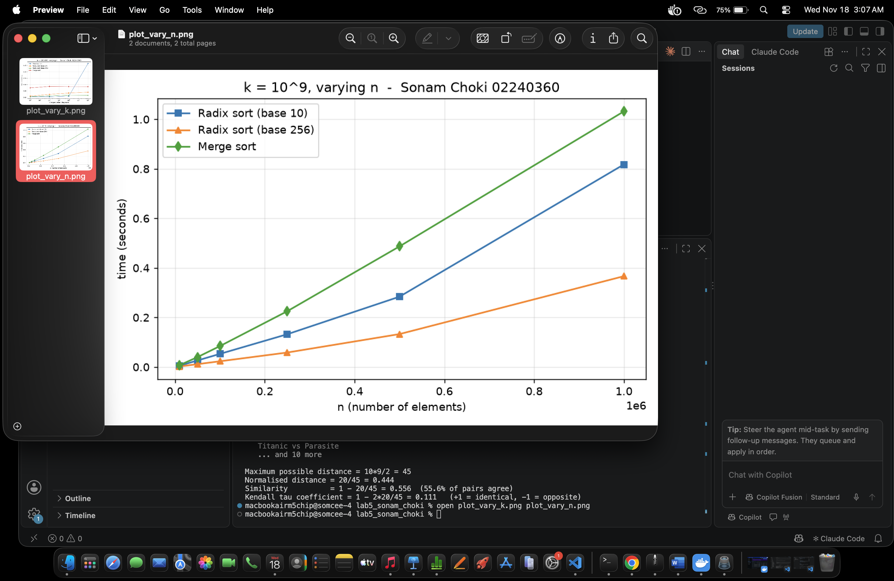
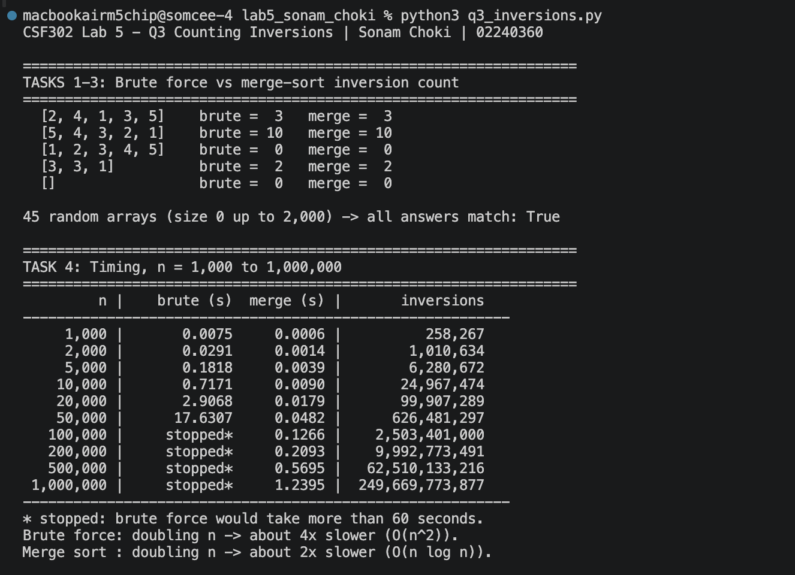
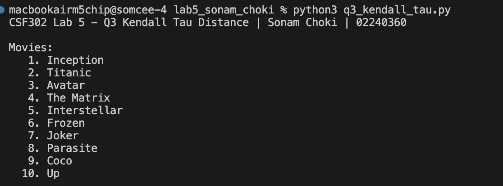
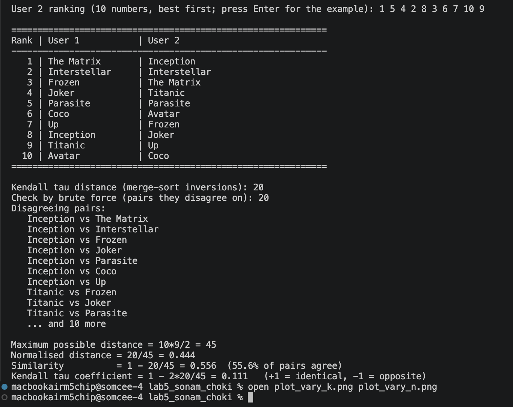

# CSF302 – Lab 5: Sorting Algorithms

**Name:** Sonam Choki
**Student Number:** 02240360

---

## Files

| File | What it contains |
|------|------------------|
| `q1_quicksort_variants.py` | Q1: Lomuto, Hoare, randomised and three-way quicksort, with comparison counts and timing |
| `q2_counting_radix.py` | Q2: counting sort, radix sort (base 10 and 256), comparison with merge sort, plots, and the stability test |
| `q3_inversions.py` | Q3 tasks 1–4: brute-force and merge-sort inversion counts, a check that they agree, and timing |
| `q3_kendall_tau.py` | Q3 task 5: Kendall tau distance between two users' movie rankings typed at the keyboard |
| `merge_sort.py` | Merge sort from Lab 1, used by Q2 and Q3 |
| `screenshots/` | Screenshots of the output and plots on my Mac |

Running `q2_counting_radix.py` also creates `plot_vary_k.png` and `plot_vary_n.png`.

---

## How to run on a Mac

1. **Unzip** `lab5_sonam_choki.zip` (double-click it in Finder).
2. **Open Terminal** (press `Cmd + Space`, type `Terminal`, press Enter).
3. **Go into the folder.** Type `cd ` with a space after it, drag the unzipped folder into the Terminal window, and press Enter. For example:
   ```bash
   cd ~/Downloads/lab5_sonam_choki
   ```
4. **Install matplotlib** (only needed once, for the Q2 plots):
   ```bash
   python3 -m pip install --user matplotlib
   ```
   If you get an "externally-managed-environment" error, use this instead:
   ```bash
   python3 -m pip install --user --break-system-packages matplotlib
   ```
   If matplotlib won't install, Q2 still runs. It just skips the plots.
5. **Run each question:**
   ```bash
   python3 q1_quicksort_variants.py     # about 30–40 seconds
   python3 q2_counting_radix.py         # about 15 seconds, saves 2 plots
   python3 q3_inversions.py             # about 40–60 seconds (brute force is slow on purpose)
   python3 q3_kendall_tau.py            # asks you to type two rankings
   ```
6. **To open the plots:**
   ```bash
   open plot_vary_k.png plot_vary_n.png
   ```

**Typing the Kendall tau input:** each user types the 10 movie numbers from favourite to least favourite, separated by spaces. Press Enter on an empty line to use the built-in example. For example:
```
User 1: 5 1 4 8 2 3 7 6 9 10
User 2: 1 5 4 2 8 3 6 7 10 9
```

---

## Summary (in simple terms)

### Q1: Quicksort variants
Quicksort picks a **pivot**, puts smaller items on its left and bigger items on its right, and then sorts each side the same way.
When the pivot splits the list roughly in half, it is fast: **O(n log n)**.
When the pivot is always the smallest or biggest item, one side is empty every time, so it becomes slow: **Θ(n²)**.

| Variant | How it picks or splits | Becomes Θ(n²) on | Why |
|---|---|---|---|
| **Lomuto** | last element as pivot | **sorted, reverse, duplicates** | The last element of a sorted list is the biggest, so it is the worst possible pivot. Items equal to the pivot all go to one side, so many duplicates also give a bad split. |
| **Hoare** | first element as pivot, two pointers moving inwards | **sorted, reverse** | The first element of a sorted list is the smallest, so the pivot is bad again. Duplicates are fine because equal items are swapped to both sides. |
| **Randomised** | random pivot + Lomuto | **duplicates** | A random pivot fixes sorted input. But it still uses Lomuto's partition, so equal items still all go to one side. |
| **Three-way** | random pivot, splits into `< = >` | **none** | All items equal to the pivot are grouped in the middle and never touched again. This works on every input type. |

**How I measured it:** I divided the number of comparisons at n = 16,000 by the number at n = 8,000.
- If the ratio is about **2**, the variant is **n log n**.
- If the ratio is about **4**, the variant is **n²**.

My results gave exactly 4.00 for Lomuto and Hoare on sorted input. At n = 16,000 on sorted input, Lomuto made about 128 million comparisons and took 4.38 s. Three-way made about 416 thousand comparisons and took 0.014 s.

**Task 7 (recursion limit):** each variant calls itself recursively on the **smaller** side and uses a loop for the **larger** side. This keeps the recursion depth at about log₂(n), so even the worst cases on sorted input never hit Python's recursion limit of 1000.

### Q2: Counting sort and radix sort
- **Counting sort** counts how many times each value 0…k appears and uses those counts to place each item directly. It runs in **O(n + k)** and makes **no comparisons**.
  It goes through the input **backwards** when placing items, which makes it **stable**: items with equal keys keep their original order. Task 7 checks this by sorting `(key, index)` pairs.
- **Radix sort (LSD)** sorts by the last digit first, then the next digit, and so on, using counting sort for each digit.
  Base 10 needs **10 passes** for numbers up to 10⁹. Base 256 needs only **4 passes**.

**When the linear-time sorts win:**
- Counting sort wins when k is small. With n = 100,000 and k = 10 it took 0.005 s, compared with 0.075 s for merge sort, about **15× faster**.
- Radix sort with base 256 wins on big numbers. At n = 1,000,000 it took 0.37 s, compared with 1.03 s for merge sort, about **2.8× faster**.

**When they lose:**
- Counting sort loses when k is much bigger than n. At k = 10⁷ the count array is huge, and counting sort took 0.26 s, making it the slowest. At k = 10⁹ it would need about 8 GB of memory, so it can't run at all.
- Radix sort with base 10 does 10 passes, so it is only a little faster than merge sort (0.82 s compared with 1.03 s at n = 1,000,000).
- Both only work for whole-number keys. Merge sort works on anything that can be compared.

### Q3: Counting inversions
An **inversion** is a pair of items that are in the wrong order (a[i] > a[j] with i < j). It measures how unsorted a list is.
- **Brute force** checks every pair. That is **O(n²)**: doubling n makes it about 4× slower. At n = 50,000 it took 17.6 s, so I stopped running it after that because larger sizes would take more than 60 seconds.
- **Merge-sort method:** while merging, whenever an item from the right half is taken first, it is smaller than **all** the items left in the left half. So all of them count as inversions in one step. That is **O(n log n)**: 1,000,000 items took only 1.24 seconds.
- Both methods give the same answer on 45 random arrays of size up to 2,000.
- **Kendall tau distance** is the number of movie pairs that two users rank in a different order. To compute it, I rewrite user 2's list using user 1's positions. Then every disagreement becomes an inversion, so the same merge-sort counter works. A similarity of 1 − d/45 shows how alike the two users' tastes are.

---

## Output (run on my MacBook Air M5)

### Q1: Quicksort variants





**What it shows:**
- All four variants pass 200 random correctness tests.
- On **sorted** and **reverse** input, Lomuto and Hoare make about 128 million comparisons at n = 16,000. Randomised and three-way make only about 260–430 thousand.
- On **duplicates**, Lomuto and Randomised make about 12.9 million comparisons, while three-way makes only 94 thousand.
- The **Task 8** table confirms this. A ratio of about 4.00 means **n²**, and a ratio of about 2 means **n log n**. Only three-way quicksort is n log n on all four input types.

### Q2: Counting sort and radix sort





**What it shows:**
- Counting sort and both radix sorts give the correct order and pass 300 random tests.
- **Task 7:** in the `(key, index)` pairs, equal keys keep their original order, so the output shows `Stable: True`.
- **Vary k:** counting sort is the fastest for small k (0.005 s) and the slowest at k = 10⁷ (0.26 s).
- **Vary n:** at n = 1,000,000, base-256 radix sort took 0.37 s, base-10 radix sort took 0.82 s, and merge sort took 1.03 s.

**Plot: n = 100,000, varying k**



The counting sort line (blue) stays near zero and then shoots up when k becomes much bigger than n. The other sorts hardly change with k.

**Plot: k = 10⁹, varying n**



All three lines grow roughly in a straight line with n. Base-256 radix sort (orange) is clearly the fastest. Merge sort (green) is the slowest.

### Q3: Counting inversions



**What it shows:**
- Brute force and the merge-sort method give the same counts on the examples and on 45 random arrays.
- Brute force took 17.6 s at n = 50,000. After that it was stopped, because larger sizes would take more than 60 s.
- The merge-sort method counted about 250 billion inversions in 1,000,000 items in 1.24 s.

### Q3 task 5: Kendall tau distance (input typed at the keyboard)





**What it shows:**
- User 1 typed `4 5 6 7 8 9 10 1 2 3` and User 2 typed `1 5 4 2 8 3 6 7 10 9`.
- The two users disagree on **20** of the 45 movie pairs. This is the Kendall tau distance, and the brute-force check gives the same number.
- **Similarity = 1 − 20/45 = 0.556**, which means 55.6% of pairs agree. The Kendall tau coefficient is 0.111, so their tastes are only slightly alike.
