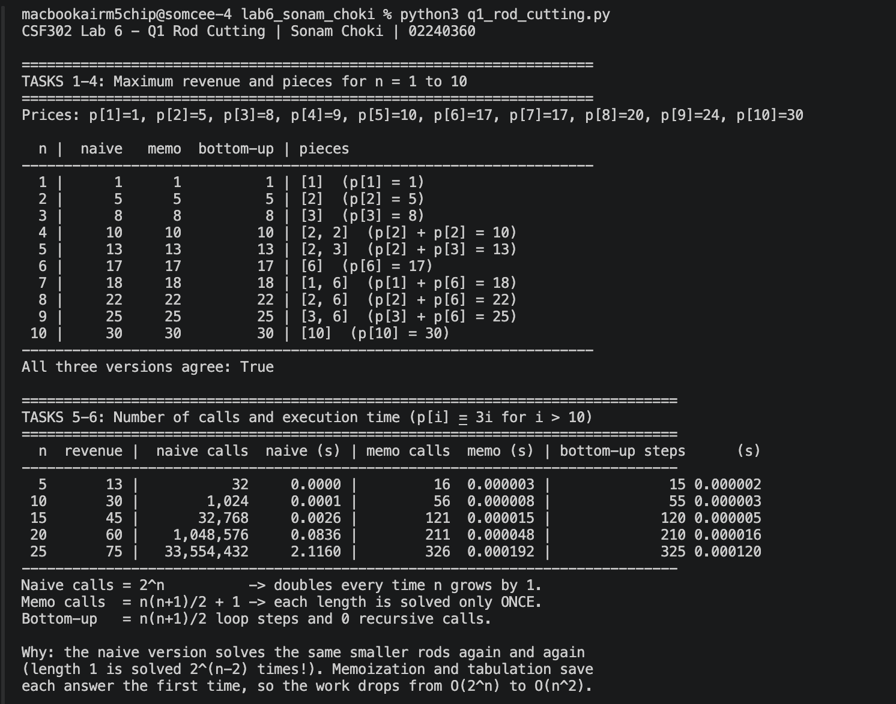
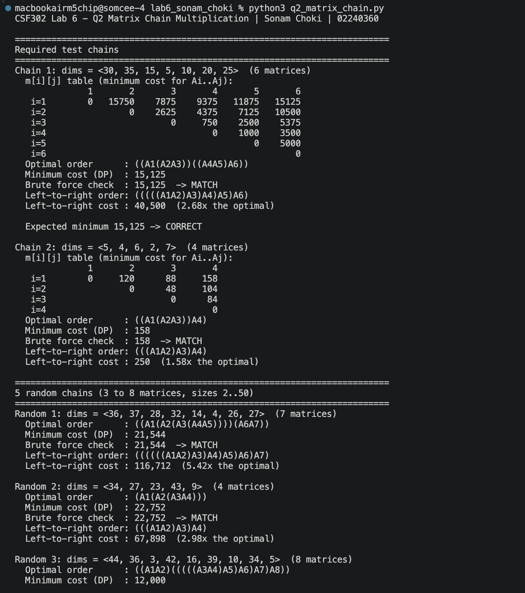
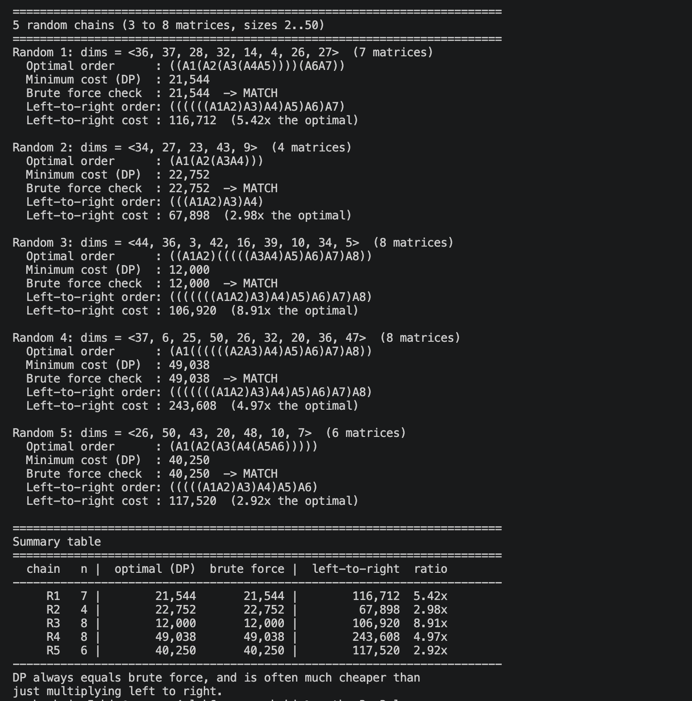
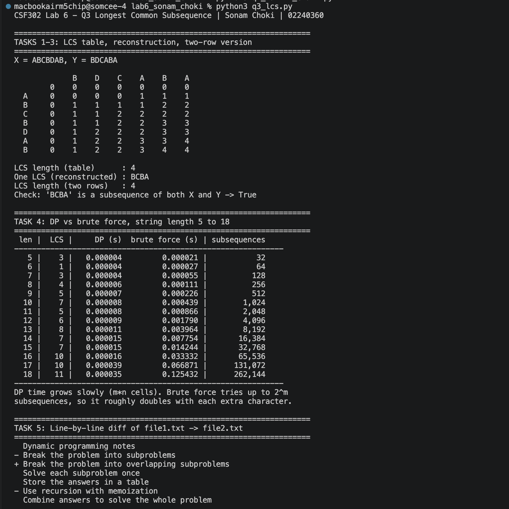
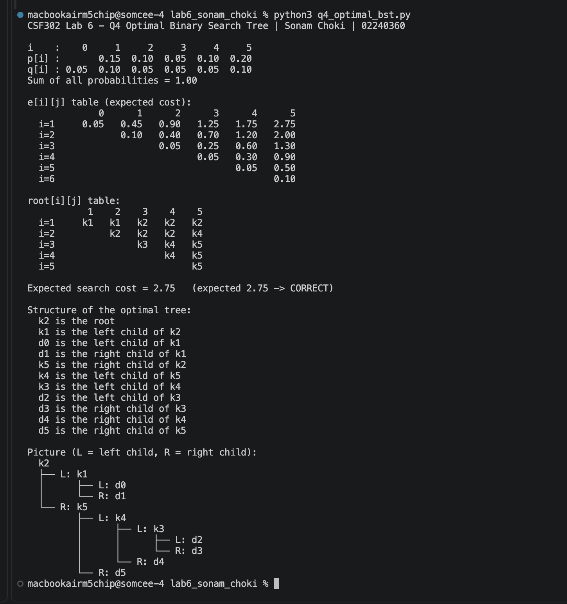

# CSF302 – Lab 6: Dynamic Programming

**Name:** Sonam Choki
**Student Number:** 02240360

---

## Files

| File | What it contains |
|------|------------------|
| `q1_rod_cutting.py` | Q1: rod cutting with naive recursion, top-down memoization and bottom-up tabulation, plus call counts and timing |
| `q2_matrix_chain.py` | Q2: matrix chain DP, the optimal brackets, a brute-force check, and the left-to-right cost |
| `q3_lcs.py` | Q3: LCS table, reconstructing an LCS, the two-row version, DP vs brute force, and a line-by-line diff |
| `q4_optimal_bst.py` | Q4 (optional): optimal binary search tree, its expected cost and its structure |
| `file1.txt`, `file2.txt` | Two short text files used for the Q3 diff |
| `screenshots/` | Screenshots of the output on my Mac |

---

## Summary 

### What is dynamic programming?
Many problems can be broken into **smaller versions of the same problem**, and the same small problems come up **again and again**.
Plain recursion solves them again every time it meets them, which is very slow.
**Dynamic programming (DP)** solves each small problem **once**, saves the answer in a table, and reuses it.
There are two ways to do this:
- **Top-down (memoization):** normal recursion, but you check the saved answers first.
- **Bottom-up (tabulation):** fill the table from the smallest problem up to the biggest, with no recursion at all.

### Q1: Rod cutting
Given a price for each piece length, how should a rod of length n be cut to earn the most money?

| n | 1 | 2 | 3 | 4 | 5 | 6 | 7 | 8 | 9 | 10 |
|---|---|---|---|---|---|---|---|---|---|---|
| Max revenue | 1 | 5 | 8 | 10 | 13 | 17 | 18 | 22 | 25 | 30 |
| Pieces | 1 | 2 | 3 | 2+2 | 2+3 | 6 | 1+6 | 2+6 | 3+6 | 10 |

- **Naive recursion** makes **2ⁿ calls**. For n = 25 that is 33,554,432 calls and took 2.1 seconds on my Mac.
- **Memoized** makes only **n(n+1)/2 + 1 calls**, which is 326 for n = 25. It took 0.0002 seconds, about 10,000× faster.
- **Bottom-up** makes **no recursive calls** and fills just n(n+1)/2 table cells.
- **Why the difference:** the naive version solves small rods again and again. For example, it solves length 1 millions of times. DP solves each length once, so the work drops from **O(2ⁿ)** to **O(n²)**.

### Q2: Matrix chain multiplication
Multiplying matrices gives the same result whatever brackets you use, but the **amount of work changes a lot**.
The DP tries every place to make the last split and keeps the cheapest. Its table `m[i][j]` holds the best cost for matrices Ai to Aj.

| Chain | Optimal order | Optimal cost | Left-to-right cost |
|---|---|---|---|
| <30,35,15,5,10,20,25> | `((A1(A2A3))((A4A5)A6))` | **15,125** ✓ | 40,500 |
| <5,4,6,2,7> | `((A1(A2A3))A4)` | **158** | 250 |

The DP answer matched the brute-force answer for all 7 chains, including the 5 random ones of up to 8 matrices.
Simply multiplying left to right cost **1.6× to 8.9× more** than the best order.

### Q3: Longest common subsequence (LCS)
A subsequence keeps the letters in order but may skip some. The LCS is the longest subsequence that appears in both strings.
- **The table:** `c[i][j]` is the LCS length of the first i letters of X and the first j letters of Y.
  - If the letters match, it is the diagonal value + 1.
  - Otherwise, it is the bigger of the value above and the value to the left.
- For X = ABCBDAB and Y = BDCABA, the **LCS length is 4**, and one LCS is **BCBA**.
- **Two-row version:** each row only needs the row above it, so keeping 2 rows is enough to get the length. This uses O(n) memory instead of O(m·n).
- **DP vs brute force:** brute force tries all 2ᵐ subsequences of X, so its time doubles with every extra letter. At length 18 it took 0.125 s, while the DP took only 0.000035 s.
- **Diff:** I treat each **line** of a file as one "letter". Lines in the LCS are unchanged, lines only in the old file are shown as removed (`-`), and lines only in the new file are shown as added (`+`). This is how tools like `git diff` work.

### Q4 (optional): Optimal binary search tree
Some keys are searched for more often than others. The best tree puts popular keys near the top so searches are short on average.
The DP tries every key as the root of every range of keys and keeps the cheapest.
- **Expected search cost = 2.75** ✓
- The root is **k2**. Its left child is k1, and its right child is k5. k4 is the left child of k5, and k3 is the left child of k4.

---

## Output 

### Q1: Rod cutting

**What it shows:**
- All three versions (naive, memo and bottom-up) give the same maximum revenue for n = 1 to 10. The output also shows which pieces to cut, for example n = 10 → [10] = 30.
- At n = 25, naive recursion made **33,554,432 calls** (2²⁵) and took **2.12 s**. Memoization made only **326 calls** and took **0.0002 s**. Bottom-up made **no recursive calls**.

### Q2: Matrix chain multiplication

**What it shows:**
- **Chain <30, 35, 15, 5, 10, 20, 25>:** the minimum cost is **15,125**, ending in `CORRECT`. The optimal order is `((A1(A2A3))((A4A5)A6))`, while left-to-right costs 40,500.
- **Chain <5, 4, 6, 2, 7>:** the minimum cost is **158** with `((A1(A2A3))A4)`, while left-to-right costs 250.
- **5 random chains:** the DP always matches brute force. Left-to-right costs **2.9× to 8.9×** more than the best order.

### Q3: Longest common subsequence

**What it shows:**
- The full LCS table for X = ABCBDAB and Y = BDCABA. The LCS length is **4**, one LCS is **BCBA**, and the two-row version also gives 4.
- **DP vs brute force:** brute force roughly doubles with each extra character and reaches 0.125 s at length 18. The DP stays at about 0.00003 s.
- **Diff:** lines in the LCS are unchanged, lines marked `-` were removed, and lines marked `+` were added.

### Q4 (optional): Optimal binary search tree

**What it shows:**
- The e[i][j] (expected cost) and root[i][j] tables.
- **Expected search cost = 2.75**, ending in `CORRECT`.
- The tree has **k2** at the root, k1 as its left child and k5 as its right child. k4 is under k5, and k3 is under k4. The dummy keys d0 to d5 are the leaves.
