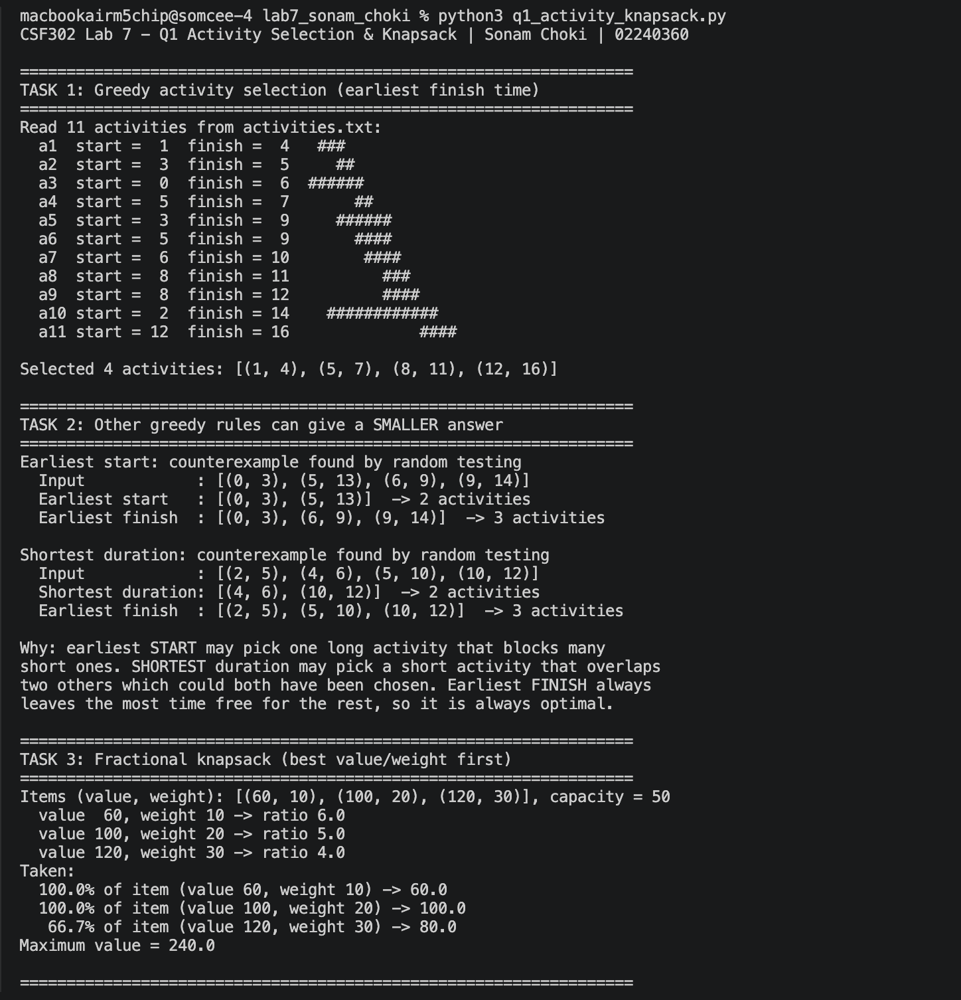
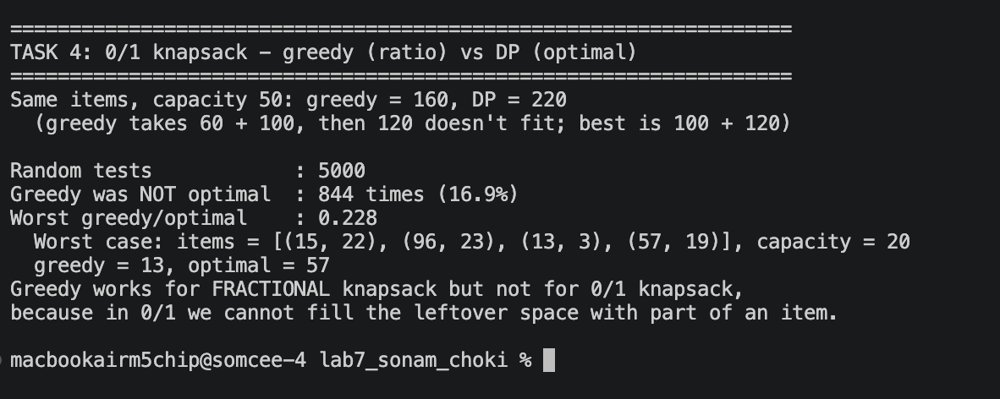
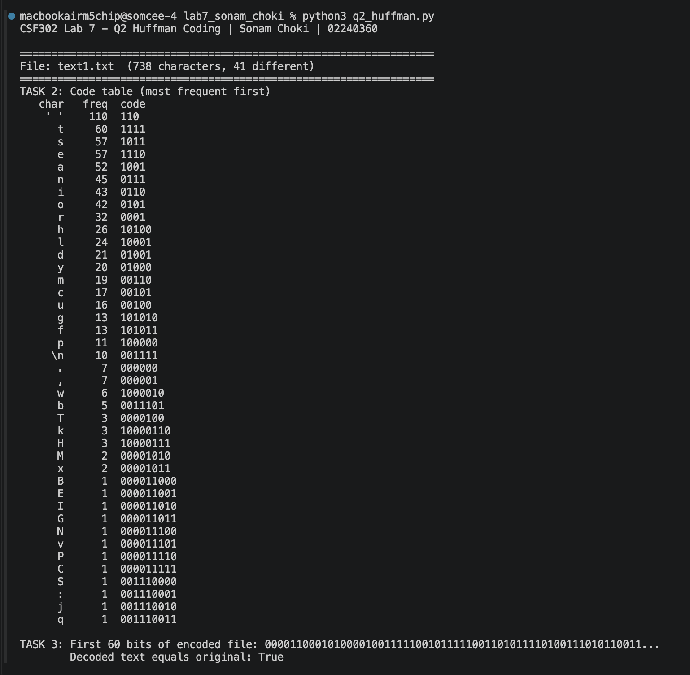
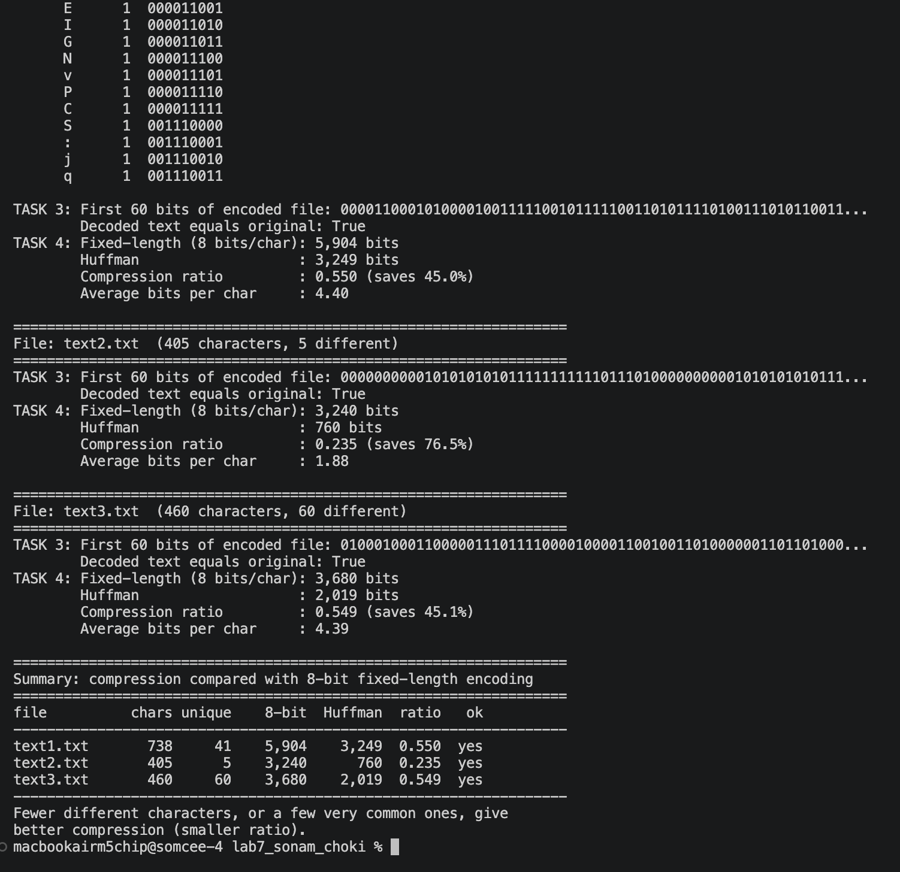
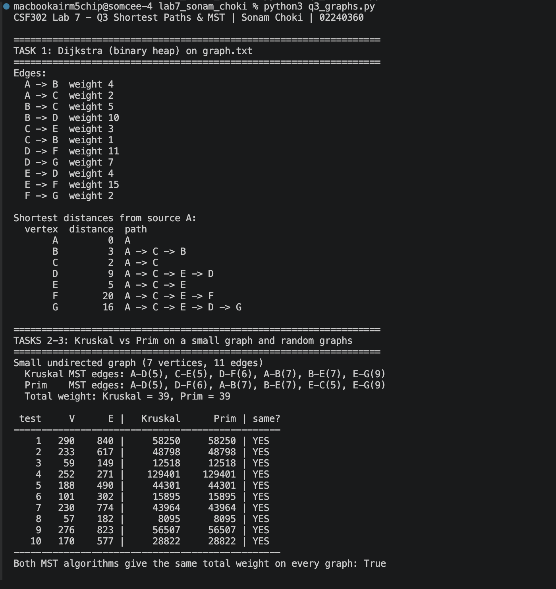
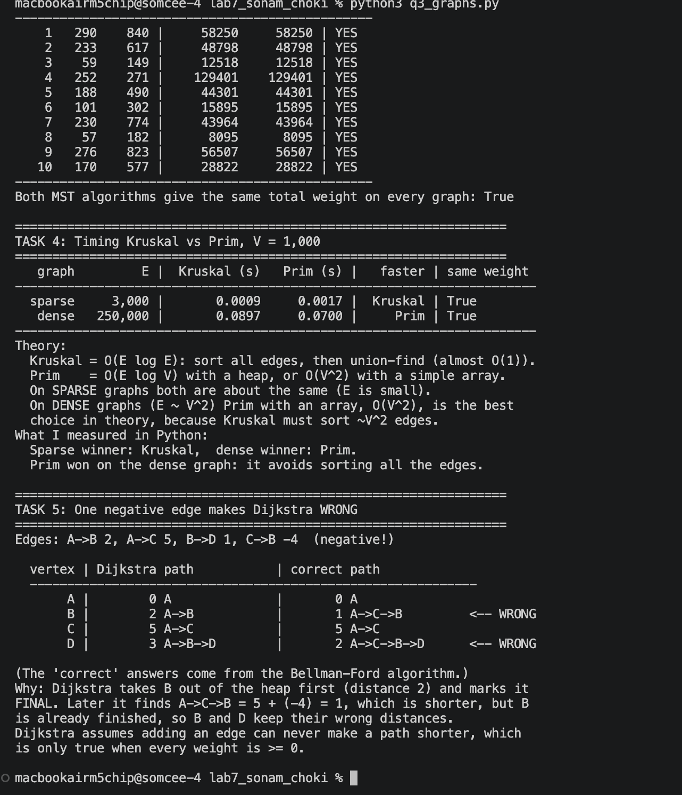
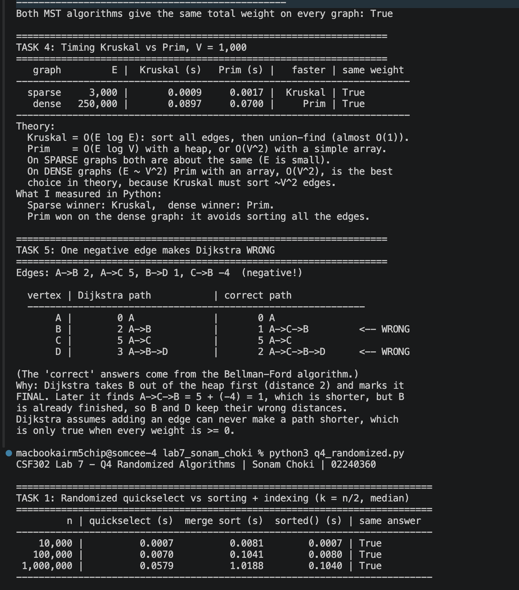
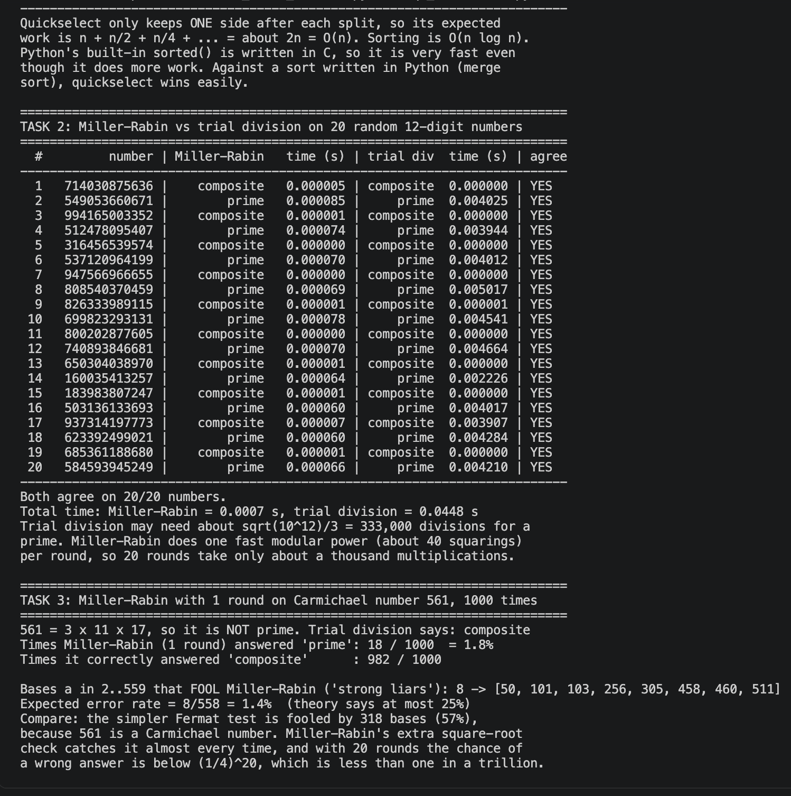

# CSF302 – Lab 7: Greedy and Randomized Algorithms

**Name:** Sonam Choki
**Student Number:** 02240360

---

## Files

| File | What it contains |
|------|------------------|
| `q1_activity_knapsack.py` | Q1: activity selection (3 greedy rules), fractional knapsack, and 0/1 knapsack greedy vs DP |
| `q2_huffman.py` | Q2: Huffman tree (heapq), code table, encode/decode, and compression ratio |
| `q3_graphs.py` | Q3: Dijkstra (heap), Kruskal (union-find), Prim (heap), timing, and the negative-edge example |
| `q4_randomized.py` | Q4: randomized quickselect, Miller–Rabin vs trial division, and the Carmichael number 561 test |
| `activities.txt` | Input for Q1: one `start finish` pair per line |
| `text1.txt`, `text2.txt`, `text3.txt` | Input for Q2: English text, a text with only a few repeated letters, and Python code |
| `graph.txt` | Input for Q3: a weighted directed graph (`from to weight`) and its source vertex |
| `screenshots/` | Screenshots of the output on my Mac |

---

## Summary 

### What is a greedy algorithm?
A greedy algorithm makes **the choice that looks best right now** and never goes back to change it.
It is fast and simple, but it only gives the best answer for some problems. For those problems, we need to show the greedy choice is always safe.

### Q1: Activity selection and knapsack
- **Activity selection:** choose the largest number of activities that don't overlap.
  - **Earliest finish first** is always optimal. It leaves the most free time for the remaining activities. From `activities.txt` it chose **4 activities**: (1,4), (5,7), (8,11) and (12,16).
  - **Earliest start first** can fail. Random testing found an input where it picks one long activity that blocks two others, so it gets 2 activities instead of 3.
  - **Shortest duration first** can fail too. Random testing found an input where it picks a short activity that overlaps two others that could both have been chosen.
- **Fractional knapsack:** we can take part of an item. Taking the **highest value/weight ratio first** is optimal. For the items in the program, the best value is **240**.
- **0/1 knapsack:** each item is taken whole or not at all, so the same greedy rule **is not optimal**.
  - On the same items it got 160, but the best is 220.
  - In 5,000 random tests greedy was wrong **16.9%** of the time.
  - The **worst ratio of greedy to optimal was 0.228**, so greedy got less than a quarter of the best value.
  - The fix is dynamic programming.

### Q2: Huffman coding
- Count how often each character appears. Then keep **joining the two least frequent nodes** (using a priority queue, `heapq`) until one tree is left.
- Going left adds a **0** and going right adds a **1**. Common characters end up near the top with **short codes**, and rare ones get long codes.
- No code is the start of another code (a **prefix code**), so decoding is never ambiguous. Decoding gave back exactly the original text for all 3 files.

| File | Kind of text | Compression ratio vs 8-bit |
|---|---|---|
| text1.txt | English paragraph | about 0.55 (45% smaller) |
| text2.txt | only the letters A, B, C, D | about 0.23 (77% smaller) |
| text3.txt | Python code with many symbols | about 0.55 |

The fewer different characters a file has, the better Huffman compresses it.

### Q3: Shortest paths and minimum spanning trees
- **Dijkstra** always takes the closest vertex that isn't finished yet (using a binary heap) and marks its distance as final. The program prints the distance and full path from A to every vertex.
- **Kruskal** sorts all edges and adds the cheapest one that doesn't make a cycle. **Union-find** checks for cycles quickly.
- **Prim** grows one tree and always adds the cheapest edge leaving it (using a heap).
- Both MST algorithms gave **the same total weight on all 10 random connected graphs**.
- **Timing at V = 1,000:**
  - In theory, both are similar on sparse graphs, and Prim (array version, O(V²)) is better on dense graphs.
  - **On my Mac:** Kruskal won on the sparse graph (0.0009 s vs 0.0017 s), and **Prim won on the dense graph** (0.070 s vs 0.090 s). This matches the theory, because Kruskal has to sort all 250,000 edges.
- **Negative edge:** with edges A→B 2, A→C 5, C→B −4 and B→D 1, Dijkstra says B = 2 and D = 3. The correct answers are **B = 1 and D = 2**.
  - This happens because Dijkstra marks B as final before it sees the cheaper path through the negative edge.

### Q4: Randomized algorithms
- **Quickselect** finds the k-th smallest element. It picks a random pivot and keeps only the side that contains the answer. The expected work is n + n/2 + n/4 + … ≈ 2n = **O(n)**, while sorting is O(n log n).
  - At n = 1,000,000 it took 0.058 s. That is about **17× faster** than a merge sort written in Python (1.02 s).
  - It was also about **1.8× faster** than Python's built-in `sorted()` (0.104 s), even though `sorted()` is written in C.
- **Miller–Rabin** tests whether a number is prime using random bases. On 20 random 12-digit numbers it **agreed with trial division 20/20 times** and was about **64× faster** (0.0007 s in total vs 0.0448 s).
- **Carmichael number 561 = 3 × 11 × 17:** this number fools the simple Fermat test for 57% of bases.
  - Miller–Rabin with **1 round** said "prime" only **18 out of 1,000 times (1.8%)**.
  - Only 8 bases out of 558 fool it.
  - With 20 rounds, the chance of a mistake is less than (1/4)²⁰.

---

## Output

### Q1: Activity selection and knapsack

**What it shows:**
- 11 activities were read from `activities.txt`. Earliest finish picks **4**: (1,4), (5,7), (8,11) and (12,16).
- **Random testing found counterexamples.** Earliest start picks 2 activities and shortest duration picks 2, while earliest finish picks 3.
- **Fractional knapsack:** it takes all of the first two items and 66.7% of the third, for a maximum value of **240**.
- **0/1 knapsack:**
  - On the same items, greedy gets 160 but the DP finds 220.
  - In 5,000 random tests, greedy was not optimal **16.9%** of the time.
  - The **worst ratio was 0.228**: greedy got 13 when the best was 57.

### Q2: Huffman coding

**What it shows:**
- **Code table for text1.txt:** the most common character is the space (110 times), and it gets a short 3-bit code, `110`. Characters that appear only once get 9-bit codes.
- `Decoded text equals original: True` appears for all 3 files.
- **Compression vs 8-bit:**

| File | Ratio | Saving |
|---|---|---|
| text1.txt (English) | 0.550 | 45.0% |
| text2.txt (only A–D) | 0.235 | 76.5% |
| text3.txt (Python code) | 0.549 | 45.1% |

### Q3: Shortest paths and minimum spanning trees

**What it shows:**
- **Dijkstra from A:** every vertex gets its distance and path. For example, G = 16 via A → C → E → D → G.
- **Kruskal and Prim** both give an MST of weight 39 on the small graph, and the same weight on all 10 random graphs.
- **Timing:** Kruskal won on the sparse graph, and **Prim won on the dense graph**.
- **Negative edge:** Dijkstra gives B = 2 and D = 3, both marked `<-- WRONG`. The correct answers are B = 1 and D = 2.

### Q4: Randomized algorithms

**What it shows:**
- **Quickselect** found the same median as sorting for every n. At n = 10⁶ it took 0.058 s, compared with 1.02 s for merge sort and 0.104 s for `sorted()`.
- **Miller–Rabin vs trial division:** they **agree on 20/20 numbers**. Miller–Rabin took 0.0007 s in total, and trial division took 0.0448 s.
- **Carmichael 561:** with 1 round, Miller–Rabin answered "prime" only **18 times out of 1000 (1.8%)**. Only 8 bases fool it, compared with 318 bases for the Fermat test.
